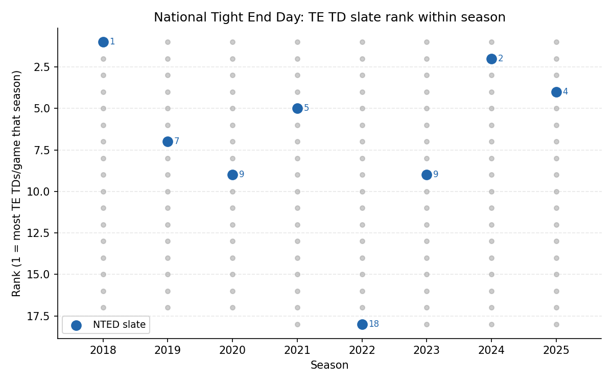
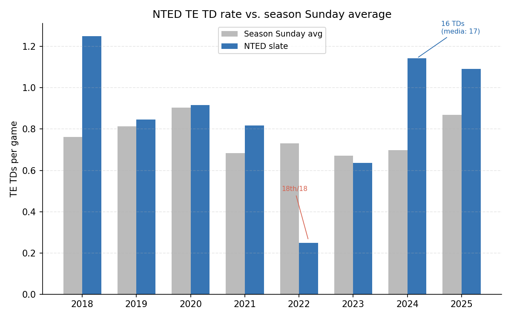

```{python}
#| echo: false
#| output: false
import pandas as pd
results = pd.read_csv("data/nted_results.csv")
slates = pd.read_csv("data/sunday_slates.csv", parse_dates=["game_date"])
```

## The Claim

<!-- TODO: origin story — Garoppolo/Kittle sideline joke in 2018, NFL made it official in 2019.
     The meme is that tight ends somehow "rise to the occasion." Does the box score agree? -->

## The Data

<!-- TODO: nflverse PBP + weekly rosters, 2018–2025. One scoring rule: td_player_id joined
     to position == "TE" in the weekly roster for that season/week. The 16-vs-17 discrepancy
     for 2024 (media reported 17; roster join gives 16) is a concrete example of why the
     estimand definition matters — mention it here. -->

## NTED by the Numbers

```{python}
#| echo: false
results[["year","nted_date","nted_te_tds","nted_games","nted_rate","season_rank","n_sunday_slates"]].rename(columns={
    "year": "Year", "nted_date": "Date", "nted_te_tds": "TE TDs",
    "nted_games": "Games", "nted_rate": "TDs/game",
    "season_rank": "Season rank", "n_sunday_slates": "Sunday slates"
})
```

<!-- TODO: walk through the table. Highlight 2018 (#1), 2024 (#2), and 2022 (dead last, 18/18).
     6 of 8 years finished in the top half of their season — that's the descriptive hook. -->



<!-- TODO: explain the rank plot — each grey dot is one Sunday slate that season, blue = NTED.
     Note the spread: NTED isn't reliably near the top, but it does cluster above the median. -->



<!-- TODO: the rate chart shows NTED beat the season average in 5 of 8 years.
     Lean on 2022 as the counter-example — don't cherry-pick the good years. -->

## Power Analysis

<!-- TODO: the permutation test. Sum-of-ranks across 8 seasons = 55 vs. expected ~74.5 under
     the null (p ≈ 0.095). Not significant at 0.05 — and that's the story, not a footnote.
     Walk through what effect size a count test could detect: +24% elevation needed for
     meaningful power. Any real mechanism (OCs game-planning around a meme) would produce
     single-digit percent. The math makes the uncertainty quantitative rather than a shrug. -->

## What the Data Can and Can't Say

<!-- TODO: confounds checklist —
  1. Week drift (7 vs 8) + byes: slate sizes vary; per-game rates fix this
  2. Secular TE usage trend 2018–2025: within-season ranking controls for it
  3. No causal lever: schedules set in May, mechanism would require intentional play-calling
  4. One estimand rule: Sunday games only, position == TE from weekly roster, all TDs
     (receiving + rushing), pre-committed before looking at the data

     Honest close: the data is *consistent with* a small positive NTED effect but
     underpowered to confirm it. The right conclusion is not "it's real" or "it's fake" —
     it's "here's exactly how much data we'd need, and we don't have it yet." -->
